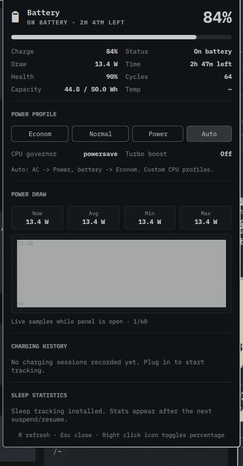

# Better Battery

Omarchy shell bar widget for battery status, with a detailed keyboard panel.



## Features

- Bar icon with optional percentage (right-click icon toggles percentage, or use widget setting).
- Panel shows: charge, status, draw, estimated time, health, cycles, capacity, temperature.
- Custom CPU power profiles (no TLP, no omarchy-powerprofiles):
  - Econom: `powersave` governor, boost off.
  - Normal: `powersave` governor, boost on.
  - Power: `performance` governor, boost on.
  - Auto: AC -> Power, battery -> Econom; reapplied on AC/battery changes.
  - Requires a one-time root helper install (`install-profile-helper`) that adds a
    narrowly scoped NOPASSWD sudoers rule for the root-owned sysfs writer.
- Charging history: active session (elapsed, gained, rate) plus recorded sessions with
  count, average rate, total gained, last session details, and a last-10 gain graph.
  - Sessions are recorded on AC plug/unplug transitions by `battery-data`, and are finalized as soon as the battery reaches 100% energy (full charge) instead of continuing while still plugged in.
  - "Clear charging history" wipes all recorded sessions.
- Sleep statistics: count, average draw, last sleep duration/time/drop/draw.
  - Install hook from panel; records via `/usr/lib/systemd/system-sleep/tyzie-battery-sleep`.
  - Sleeps that stay on AC (plugged in both before suspend and after resume) are skipped,
    so only battery-powered sleeps are recorded.
  - "Clear sleep stats" wipes all recorded sleeps for a fresh start; tracking stays installed.

## Install

```bash
omarchy plugin add <repository-url> --enable
```

The widget appears in the right side of the bar by default. Move it with:

```bash
omarchy bar move tyzie.battery --section right
```

Right-click the bar icon to toggle the on-bar percentage, or set `showPercentage`
in the widget settings. `pollIntervalSec` controls how often the open panel refreshes.

## Requirements

- `bash`, `jq`, `awk`, and a battery exposed through `/sys/class/power_supply`
  (UPower is used as a fallback).
- Root access is only needed if you opt into the CPU profile helper or the sleep
  tracking hook. Both are installed from the panel and are never required for the
  basic battery widget.

## Files

- `Panel.qml` - bar widget + keyboard panel UI
- `Model.js` - formatting/helpers
- `bin/battery-data` - JSON snapshot for panel
- `bin/battery-action` - profile actions, auto-sync, helper/hook install, clear stats
- `bin/battery-sleep-hook` - suspend/resume logger
- `bin/battery-profile-helper` - root-owned sysfs writer for CPU governor and boost
- `lib/common.sh` - shared shell helpers

## License

MIT — see [LICENSE](LICENSE).
